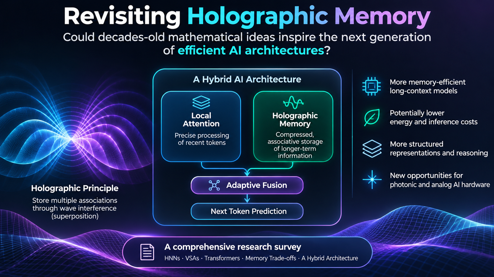

# From Optical Interference to Latent Superposition

**A Comprehensive Survey on Holographic Neural Networks, Vector Symbolic Architectures, and Their Potential in Modern AI**

**[Read the full paper (PDF)](Holographic_Neural_Networks_and_Vector_Symbolic_Architectures.pdf)**  
**[Holographic AI — An Engineer's Quick Guide](ENGINEERS_QUICK_GUIDE.md)**

<!-- Upload the generated image to assets/holographic_memory_overview.png to display the graphic here. -->


*Illustrative overview of the proposed hybrid architecture (conceptual, not an experimentally validated implementation).*

**Author:** Murat Durmus  
**Manuscript date:** November 23, 2026  
**Status:** Research survey / preprint; independent verification and peer review remain outstanding.

## Overview

This research survey connects four related lines of work:

- Classical holographic neural networks and optical associative memory
- Holographic reduced representations (HRR/FHRR), vector symbolic architectures (VSA), and hyperdimensional computing (HDC)
- Complex-valued neural networks, spectral token mixing, linear attention, and state-space models
- Photonic, analog, and low-power hardware implementations

The paper develops a common complex-phasor framework for binding, bundling, and unbinding; examines crosstalk and retrieval-capacity trade-offs; and discusses potential hybrid holographic memory architectures for long-context systems.

**Important:** Proposed constant-size holographic memory modules are conceptual research directions, not experimentally established drop-in replacements for Transformer KV caches. The fixed-size trace trades storage growth for interference and finite retrieval capacity.

## Repository structure

```text
.
├── Holographic_Neural_Networks_and_Vector_Symbolic_Architectures.pdf  # Published manuscript
├── main.tex                         # Main LaTeX source
├── main.bbl                         # Bibliography output included with project
├── references.bib                   # Bibliography source
├── sections/                        # Seven manuscript sections
│   ├── 01_intro.tex
│   ├── 02_math.tex
│   ├── 03_history.tex
│   ├── 04_comparison.tex
│   ├── 05_applications.tex
│   ├── 06_potentials.tex
│   └── 07_conclusion.tex
├── figures/                         # Figures, data, and simulation scripts
│   ├── fig_algebra.tex
│   ├── fig_capacity.tex
│   ├── fig_genealogy.tex
│   ├── fig_hybrid_arch.tex
│   ├── capacity_snr.dat
│   ├── simulate_capacity.py
│   ├── simulate_correlated_keys.py
│   └── README.md
├── ENGINEERS_QUICK_GUIDE.md          # Short, accessible engineering overview
├── BIB_VERIFICATION.md              # Bibliography review notes
├── REVISION_REPORT.md               # Revision and validation status
├── AGENTS.md                        # Project agent instructions
├── .gitignore                       # Generated-file exclusions
└── README.md                        # Repository documentation
```

The PDF uses a descriptive publication filename. **`main.tex` remains the LaTeX entry point** and should not be renamed just to match the PDF.

## Build the manuscript

Install a LaTeX distribution with `pdflatex`, `bibtex`, TikZ, and PGFPlots (for example, TeX Live). From the project root, run:

```bash
pdflatex -interaction=nonstopmode main.tex
bibtex main
pdflatex -interaction=nonstopmode main.tex
pdflatex -interaction=nonstopmode main.tex
```

Alternatively, if `latexmk` is installed:

```bash
latexmk -pdf main.tex
```

The default commands above produce `main.pdf` locally. To compile directly to the published filename with `latexmk`, use:

```bash
latexmk -pdf -jobname=Holographic_Neural_Networks_and_Vector_Symbolic_Architectures main.tex
```

The published document is [`Holographic_Neural_Networks_and_Vector_Symbolic_Architectures.pdf`](Holographic_Neural_Networks_and_Vector_Symbolic_Architectures.pdf).

## Run simulations

Requires Python 3 with NumPy. Matplotlib is optional for PDF previews.

```bash
python -m pip install numpy matplotlib
python figures/simulate_capacity.py --help
python figures/simulate_correlated_keys.py
```

The first script examines Monte Carlo crosstalk and signal-to-noise behavior under the paper's random-code assumptions. The second explores retrieval under correlated keys as a stress test; its results should not be treated as broad language-model benchmarks.

## Proposed evaluation with nanoGPT

A practical next step is to test the **conceptual hybrid holographic memory** from Section 6.1 using [nanoGPT](https://github.com/karpathy/nanoGPT) as a small, understandable Transformer baseline.

1. **Establish a baseline:** Train and evaluate unmodified nanoGPT on synthetic key–value recall and selective-copying tasks.
2. **Implement the memory module:** Add spectral phase-based key–value binding, a fixed-size recurrent holographic trace, and conjugate-key retrieval. Start with a standalone test of write/read correctness.
3. **Build the hybrid variant:** Combine local sliding-window attention with holographic memory for older tokens, including a learned fusion gate and retrieval cleanup if needed.
4. **Compare fairly:** Use the same datasets, context lengths, training-token budgets, and comparable model sizes. Report retrieval accuracy versus context length, validation loss, peak GPU/KV-memory use, tokens per second, and training stability. Include repeated random seeds and tests with correlated keys.

Compare **standard nanoGPT**, a **holographic-memory variant**, and a **local-attention + holographic-memory hybrid**. Start with short synthetic sequences, then increase length and difficulty before attempting natural-language benchmarks.

**Status:** This is an **evaluation plan**, not a completed nanoGPT implementation or performance claim. The repository's existing Python scripts test mathematical memory properties, not end-to-end language-model quality. Fixed-size memory has finite information capacity, so exact long-range recall may degrade as the load increases. The most useful result—positive or negative—would identify the accuracy, memory, and speed trade-offs against the baseline.

## Reproducibility and limitations

The supplied revised manuscript contains embedded simulation code and a correlated-key experiment. The complete original Monte Carlo sweep was not fully reproduced during the previous review; smaller functionality checks were performed. In addition, not every bibliographic record or mathematical proof has been independently verified. Consult `REVISION_REPORT.md` and `BIB_VERIFICATION.md` before quoting validation status.

This is primarily a **survey and theoretical synthesis**, not a claim of measured end-to-end superiority over modern attention or state-space architectures.

## Citation

Until a formal publication record or DOI is available, cite the manuscript as:

> Durmus, M. (2026). *From Optical Interference to Latent Superposition: A Comprehensive Survey on Holographic Neural Networks, Vector Symbolic Architectures, and Their Potential in Modern AI*. Research manuscript.

## AI assistance disclosure

This manuscript and its supporting materials were prepared with the assistance of **Gemini 4 Neon** and **GPT-6 Sol**. These AI systems supported drafting, editing, technical review, and research-project preparation. **Murat Durmus is the author and retains responsibility for the manuscript's content, mathematical claims, references, and conclusions.** AI assistance does not imply that all results have been independently verified.

## License

**No license has been specified.** All rights remain reserved unless the repository owner chooses to add a license. Please open an issue for questions about reuse or contributions.
